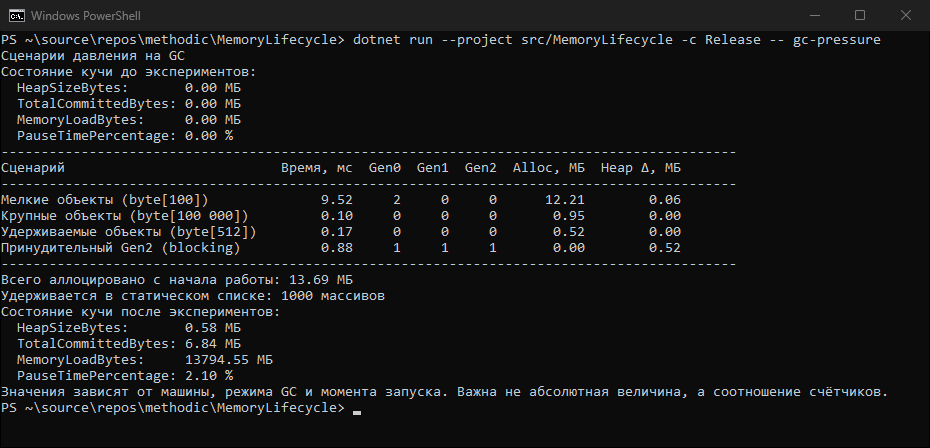
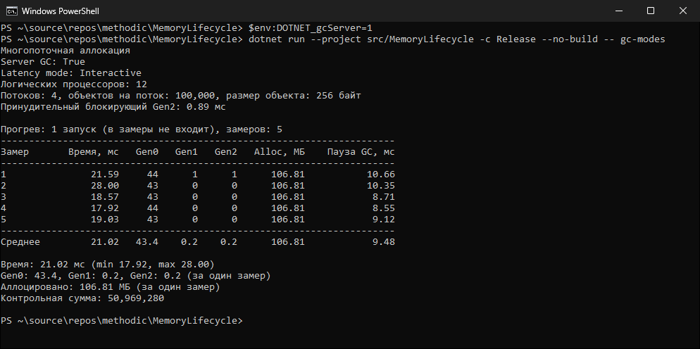
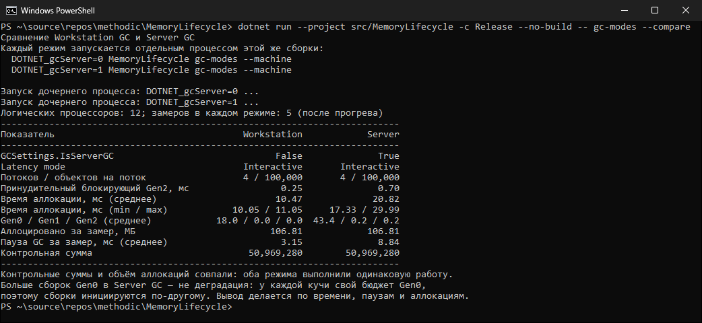

# MemoryLifecycle

Консольный проект на .NET 10 для исследования сборки мусора и управления временем жизни объектов:
от наблюдения за поколениями GC до корректного освобождения управляемых и нативных ресурсов.
Выполнен в рамках контрольной точки по дисциплине «Язык программирования C#» (КТ №40–43).

## Стек и окружение

- .NET 10 SDK (проверено на 10.0.403, проверка: `dotnet --version`);
- C# 14, включены nullable-ссылочные типы;
- Git, GitHub;
- дополнительные NuGet-пакеты не требуются.

## Структура

```text
MemoryLifecycle/
├── .gitignore
├── MemoryLifecycle.sln
├── README.md
├── docs/
│   ├── 01-gc.md
│   ├── 02-gc-modes.md
│   └── screenshots/
└── src/
    └── MemoryLifecycle/
        ├── MemoryLifecycle.csproj
        ├── Program.cs
        └── Gc/
            ├── GcModeScenarios.cs
            ├── GcObserver.cs
            ├── GcSnapshot.cs
            └── PressureScenarios.cs
```

- `Gc` — снимки счётчиков GC и сценарии нагрузки;
- `docs` — отчёты по темам и скриншоты запусков.

## Сборка и запуск

Все команды выполняются из корня репозитория.

```bash
dotnet build src/MemoryLifecycle/MemoryLifecycle.csproj -c Release
```

| Тема | Команда | Что делает |
|---|---|---|
| КТ №40 | `dotnet run --project src/MemoryLifecycle -c Release -- gc-pressure` | Поколения и давление на кучу |
| КТ №41 | `dotnet run --project src/MemoryLifecycle -c Release -- gc-modes` | Многопоточная аллокация в текущем режиме GC |
| КТ №41 | `dotnet run --project src/MemoryLifecycle -c Release -- gc-modes --compare` | Запуск в Workstation и Server GC и сравнение |

```bash
dotnet run --project src/MemoryLifecycle -c Release -- gc-pressure
dotnet run --project src/MemoryLifecycle -c Release -- gc-modes
dotnet run --project src/MemoryLifecycle -c Release -- gc-modes --compare
```

Сравнение режимов GC вручную (PowerShell; в cmd.exe — `set DOTNET_gcServer=1`, в bash — `DOTNET_gcServer=1 dotnet run ...`):

```powershell
$env:DOTNET_gcServer=0
dotnet run --project src/MemoryLifecycle -c Release --no-build -- gc-modes
$env:DOTNET_gcServer=1
dotnet run --project src/MemoryLifecycle -c Release --no-build -- gc-modes
Remove-Item Env:DOTNET_gcServer
```

## Варианты заданий

| Тема | Вариант | Модули |
|---|---|---|
| КТ №40 | 2 — «Измерение давления» | `GcSnapshot`, `GcObserver`, `PressureScenarios` |
| КТ №41 | 2 — «Многопоточная аллокация» | `GcModeScenarios` |

## Результаты

Значения получены на одной машине и при повторном запуске будут немного отличаться: важна не абсолютная величина, а соотношение показателей. Текстовый вывод каждой команды приведён в отчётах `docs`, скриншоты — дополнение к нему.

### КТ №40. Поколения и давление на кучу

Команда: `dotnet run --project src/MemoryLifecycle -c Release -- gc-pressure` (Workstation GC по умолчанию).
Условия запуска: Intel Core i7-9750H (6 ядер / 12 потоков), 16 ГБ ОЗУ, Windows 11 (10.0.26100), .NET SDK 10.0.403, конфигурация Release, без отладчика.

| Сценарий | Время, мс | Gen0 | Gen1 | Gen2 | Alloc, МБ | Heap Δ, МБ |
|---|---:|---:|---:|---:|---:|---:|
| Мелкие объекты (byte[100], 100 000 шт.) | 9.52 | 2 | 0 | 0 | 12.21 | 0.06 |
| Крупные объекты (byte[100 000], 10 шт.) | 0.10 | 0 | 0 | 0 | 0.95 | 0.00 |
| Удерживаемые объекты (byte[512], 1 000 шт., статический список) | 0.17 | 0 | 0 | 0 | 0.52 | 0.00 |
| Принудительный Gen2 (blocking) | 0.88 | 1 | 1 | 1 | 0.00 | 0.52 |

Всего аллоцировано с начала работы: 13.69 МБ. Состояние кучи до экспериментов: `HeapSizeBytes = 0.00 МБ`
(сборок ещё не было, а `GetGCMemoryInfo` описывает последнюю завершённую сборку); после — `HeapSizeBytes = 0.58 МБ`,
`TotalCommittedBytes = 6.84 МБ`, `PauseTimePercentage = 2.10 %`.

Выводы:

1. **Gen0 нагружают мелкие короткоживущие объекты**: 12.21 МБ аллокаций дали 2 сборки Gen0, а Gen2 не потребовался —
   объекты умирают молодыми.
2. **Gen2 нагружает только полная сборка**, и её переживают долгоживущие данные: после принудительного Gen2
   в куче остались 0.52 МБ из статического списка (`Heap Δ`), а крупные массивы из локального списка были собраны.
3. **LOH не всегда приводит к немедленной сборке**: крупные массивы (> 85 000 байт) сразу попадают в LOH и не
   расходуют бюджет Gen0, но счётчик Gen2 растёт только при сборке Gen2, а бюджета LOH хватило.

Подробный отчёт: [docs/01-gc.md](docs/01-gc.md).



### КТ №41. Workstation и Server GC

Команды: `gc-modes` с `DOTNET_gcServer=0` и `DOTNET_gcServer=1` (см. «Сборка и запуск»), затем `gc-modes --compare`.
Условия запуска: Intel Core i7-9750H (6 ядер / 12 потоков), 16 ГБ ОЗУ, Windows 11 (10.0.26100), .NET SDK 10.0.403, конфигурация Release, без отладчика. Нагрузка: 4 потока × 100 000 объектов `byte[256]`; прогрев + 5 замеров, в таблицах — среднее.

**Workstation GC** (`DOTNET_gcServer=0`):

| Показатель | Значение |
|---|---|
| Server GC | False |
| Latency mode | Interactive |
| Потоков / объектов на поток | 4 / 100 000 |
| Принудительный блокирующий Gen2 | 0.29 мс |
| Время параллельной аллокации | 11.69 мс (min 10.17, max 12.44) |
| Gen0 / Gen1 / Gen2 за замер | 18 / 0 / 0 |
| Суммарная пауза GC за замер | 3.57 мс |
| Аллоцировано | 106.81 МБ |
| Контрольная сумма | 50 969 280 |

**Server GC** (`DOTNET_gcServer=1`):

| Показатель | Значение |
|---|---|
| Server GC | True |
| Latency mode | Interactive |
| Потоков / объектов на поток | 4 / 100 000 |
| Принудительный блокирующий Gen2 | 0.89 мс |
| Время параллельной аллокации | 21.02 мс (min 17.92, max 28.00) |
| Gen0 / Gen1 / Gen2 за замер | 43.4 / 0.2 / 0.2 |
| Суммарная пауза GC за замер | 9.48 мс |
| Аллоцировано | 106.81 МБ |
| Контрольная сумма | 50 969 280 |

Повторное сравнение `gc-modes --compare` (оба режима в отдельных процессах): Workstation — 10.47 мс, Gen0 18.0,
пауза 3.15 мс; Server — 20.82 мс, Gen0 43.4, пауза 8.84 мс; аллокации и контрольные суммы совпали.

| Режим | Server GC | Время, мс | Gen0 | Gen2 | Пауза GC, мс |
|---|---|---:|---:|---:|---:|
| Workstation | false | 11.69 | 18.0 | 0.0 | 3.57 |
| Server | true | 21.02 | 43.4 | 0.2 | 9.48 |

Выводы:

1. Режим действительно переключился (`GCSettings.IsServerGC` = False / True), а работа одинакова
   (106.81 МБ и одинаковая контрольная сумма) — сравнение корректно.
2. **Больше сборок Gen0 в Server GC — не деградация**: у каждой кучи свой бюджет Gen0, а включённый по умолчанию
   DATAS держит бюджет пропорциональным объёму живых данных (здесь он почти нулевой). С выключенным DATAS
   (`DOTNET_GCDynamicAdaptationMode=0`) тот же сценарий в Server GC дал ≈1.2 сборки Gen0 за замер.
3. **Server GC не всегда быстрее**: на короткой нагрузке (~107 МБ за десятки миллисекунд) накладные расходы
   нескольких куч и потоков сборки перевесили выигрыш; пауза принудительного Gen2 тоже больше, так как обходятся
   все кучи. Вывод о преимуществе режима делается по нескольким замерам и длительной нагрузке, а не по одному запуску.

Подробный отчёт: [docs/02-gc-modes.md](docs/02-gc-modes.md).





## Автор

adlkalca, группа 10924-1.
