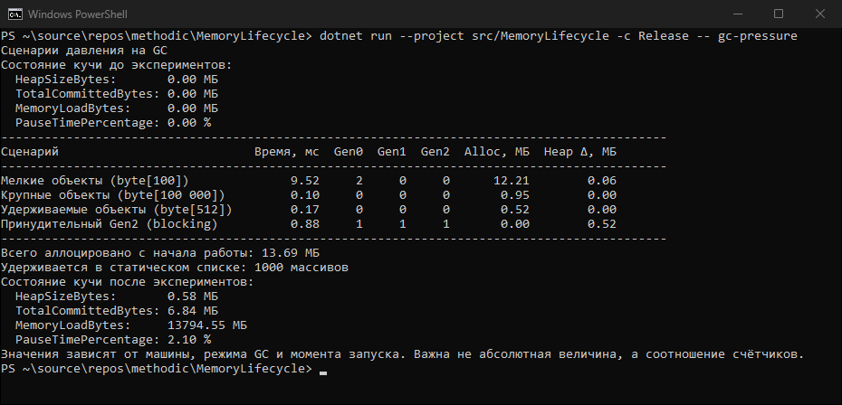

# КТ №40. GC в .NET 10: поколения, регионы памяти (DATAS)

**Вариант:** 2 — «Измерение давления».
**Команда:** `dotnet run --project src/MemoryLifecycle -c Release -- gc-pressure`

## Что реализовано

| Файл | Назначение |
|---|---|
| `src/MemoryLifecycle/Gc/GcSnapshot.cs` | `GcSnapshot` — снимок `GC.CollectionCount(0/1/2)`, `GC.GetTotalAllocatedBytes(precise: true)`, `GC.GetGCMemoryInfo().HeapSizeBytes`; `GcDelta` — прирост между снимками |
| `src/MemoryLifecycle/Gc/GcObserver.cs` | Вывод `HeapSizeBytes`, `TotalCommittedBytes`, `MemoryLoadBytes`, `PauseTimePercentage` |
| `src/MemoryLifecycle/Gc/PressureScenarios.cs` | Сценарии нагрузки и таблица результатов |

Выполнение условий варианта 2:

1. `GC.GetTotalAllocatedBytes()` фиксируется в начале работы (`RunAll`), в конце выводится общий объём аллокаций.
2. Три сценария в отдельных методах, снимки до и после каждого:
   - `RunSmallObjects` — 100 000 массивов `byte[100]`, ссылки не сохраняются;
   - `RunLargeObjects` — 10 массивов `byte[100_000]` (больше порога LOH 85 000 байт);
   - `RunLongLived` — 1 000 массивов `byte[512]` в статическом списке `LongLivedStore`.
   Четвёртый сценарий `RunForcedGen2` — принудительная блокирующая сборка Gen2, чтобы увидеть судьбу удерживаемых объектов.
3. Для каждого сценария выводится разница аллоцированных байт (в МБ).
4. Для каждого сценария выводятся Gen0, Gen1, Gen2; причины различий объяснены в комментариях к коду каждого метода.

Чтобы JIT не удалил аллокации, используется контрольная сумма `checksum` и `GC.KeepAlive`.

## Условия запуска

Intel Core i7-9750H (6 ядер / 12 потоков), 16 ГБ ОЗУ, Windows 11 (10.0.26100), .NET SDK 10.0.403,
конфигурация Release, без отладчика, Workstation GC (режим по умолчанию для консольного приложения).

## Вывод программы

```text
PS> dotnet run --project src/MemoryLifecycle -c Release -- gc-pressure
Сценарии давления на GC
Состояние кучи до экспериментов:
  HeapSizeBytes:       0.00 МБ
  TotalCommittedBytes: 0.00 МБ
  MemoryLoadBytes:     0.00 МБ
  PauseTimePercentage: 0.00 %
--------------------------------------------------------------------------------------------
Сценарий                           Время, мс  Gen0  Gen1  Gen2  Alloc, МБ  Heap Δ, МБ
--------------------------------------------------------------------------------------------
Мелкие объекты (byte[100])              9.52     2     0     0      12.21        0.06
Крупные объекты (byte[100 000])         0.10     0     0     0       0.95        0.00
Удерживаемые объекты (byte[512])        0.17     0     0     0       0.52        0.00
Принудительный Gen2 (blocking)          0.88     1     1     1       0.00        0.52
--------------------------------------------------------------------------------------------
Всего аллоцировано с начала работы: 13.69 МБ
Удерживается в статическом списке: 1000 массивов
Состояние кучи после экспериментов:
  HeapSizeBytes:       0.58 МБ
  TotalCommittedBytes: 6.84 МБ
  MemoryLoadBytes:     13794.55 МБ
  PauseTimePercentage: 2.10 %
Значения зависят от машины, режима GC и момента запуска. Важна не абсолютная величина, а соотношение счётчиков.
```



## Результаты

| Сценарий | Время, мс | Gen0 | Gen1 | Gen2 | Alloc, МБ | Heap Δ, МБ |
|---|---:|---:|---:|---:|---:|---:|
| Мелкие объекты (byte[100], 100 000 шт.) | 9.52 | 2 | 0 | 0 | 12.21 | 0.06 |
| Крупные объекты (byte[100 000], 10 шт.) | 0.10 | 0 | 0 | 0 | 0.95 | 0.00 |
| Удерживаемые объекты (byte[512], 1 000 шт.) | 0.17 | 0 | 0 | 0 | 0.52 | 0.00 |
| Принудительный Gen2 (blocking) | 0.88 | 1 | 1 | 1 | 0.00 | 0.52 |

## Анализ

- **До экспериментов `HeapSizeBytes = 0.00 МБ`.** Это не ошибка: `GC.GetGCMemoryInfo()` описывает последнюю
  завершённую сборку, а к моменту первого вывода сборок ещё не было.
- **Мелкие объекты нагружают Gen0.** 100 000 × 128 байт (100 байт данных + 24 байта заголовка массива, с выравниванием) ≈ 12.21 МБ —
  больше бюджета Gen0, поэтому прошло 2 сборки Gen0. Объекты сразу становятся мусором и умирают молодыми,
  переживать сборку нечему — Gen2 = 0 (гипотеза о смертности молодых объектов).
- **Крупные объекты не трогают Gen0.** 0.95 МБ аллокаций, но Gen0 = 0: массивы по 100 000 байт превышают
  порог 85 000 байт и размещаются сразу в LOH. LOH логически входит в Gen2, однако счётчик Gen2 растёт
  только при *сборке* Gen2, а бюджета LOH хватило — сборка не запускалась.
- **Удерживаемые объекты.** 0.52 МБ меньше бюджета Gen0 — сборок нет. Отличие от мелких объектов в их судьбе:
  массивы достижимы из статического списка. После принудительной сборки `Heap Δ = 0.52 МБ`, а `HeapSizeBytes`
  после экспериментов — 0.58 МБ: эти 1 000 массивов пережили полную сборку и остались в куче
  (продвинуты в старшее поколение), а крупные массивы из локального списка были собраны.
- **Принудительный Gen2 увеличил все три счётчика на 1**: полная сборка Gen2 учитывается и как сборка
  Gen0 и Gen1. Пауза 0.88 мс невелика, потому что живых данных мало; в реальном приложении она может
  составлять десятки и сотни миллисекунд, поэтому `GC.Collect` в рабочем коде не вызывают.
- `TotalCommittedBytes` (6.84 МБ) больше `HeapSizeBytes` (0.58 МБ): сборщик держит зарезервированную у ОС
  память под регионы и не отдаёт её сразу. `MemoryLoadBytes` — загрузка памяти всей машины, а не процесса.

## Выводы

1. Gen0 нагружает сценарий с большим числом короткоживущих мелких объектов.
2. Gen2 нагружает только полная сборка; долгоживущие данные (статический список) переживают её
   и остаются в куче — это видно по `HeapSizeBytes` после сборки.
3. Крупный объект попадает в LOH, но это не приводит к немедленной сборке: счётчик Gen2 растёт только
   когда исчерпан бюджет LOH/Gen2 или сборка вызвана явно.
