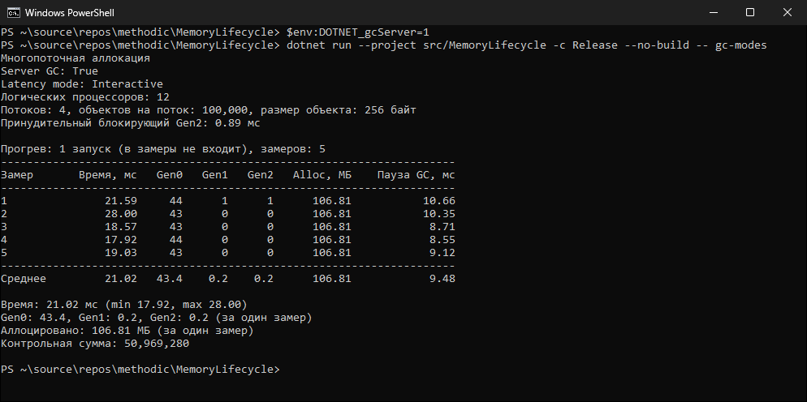
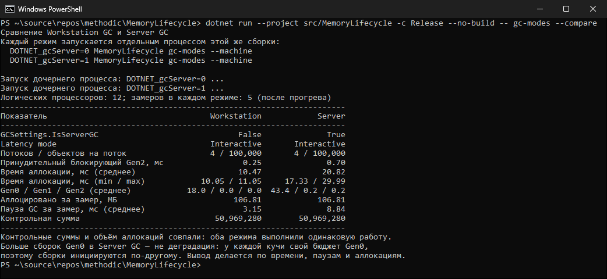

# КТ №41. Параллельная и фоновая сборка мусора

**Вариант:** 2 — «Многопоточная аллокация».
**Файл:** `src/MemoryLifecycle/Gc/GcModeScenarios.cs`, команда `gc-modes`.

## Что реализовано

1. Четыре параллельные задачи `Task.Run`, каждая создаёт в цикле 100 000 объектов `new byte[256]`.
2. Счётчики Gen0/Gen1/Gen2 (`GcSnapshot`) фиксируются до запуска задач и после `Task.WhenAll`.
3. Время измеряется `Stopwatch`. Чтобы один случайный запуск не стал «доказательством», сначала выполняется
   прогон-прогрев (JIT, пул потоков), затем 5 замеров; в выводах используется среднее, min и max.
4. Дополнительно измеряется суммарная пауза GC за замер (`GC.GetTotalPauseDuration()`) и отдельным
   `Stopwatch` — пауза принудительной блокирующей сборки `GC.Collect(2, GCCollectionMode.Forced, blocking: true)`;
   она не входит во время аллокации.
5. В каждом запуске выводится `GCSettings.IsServerGC` и `GCSettings.LatencyMode` — доказательство того, что режим
   действительно переключился. Контрольная сумма доказывает, что работа в обоих режимах одинакова.
6. Режим переключается переменной окружения `DOTNET_gcServer` (без правки `.csproj`). Альтернатива —
   свойство `<ServerGarbageCollection>true</ServerGarbageCollection>` в `MemoryLifecycle.csproj`.
7. `gc-modes --compare` сама запускает два дочерних процесса этой же сборки с `DOTNET_gcServer=0` и `=1`
   и печатает сравнение в одной таблице (режим GC выбирается при старте процесса, поэтому нужны два процесса).

## Команды

PowerShell:

```powershell
dotnet build src/MemoryLifecycle/MemoryLifecycle.csproj -c Release

$env:DOTNET_gcServer=0
dotnet run --project src/MemoryLifecycle -c Release --no-build -- gc-modes

$env:DOTNET_gcServer=1
dotnet run --project src/MemoryLifecycle -c Release --no-build -- gc-modes

Remove-Item Env:DOTNET_gcServer
dotnet run --project src/MemoryLifecycle -c Release --no-build -- gc-modes --compare
```

bash:

```bash
DOTNET_gcServer=0 dotnet run --project src/MemoryLifecycle -c Release --no-build -- gc-modes
DOTNET_gcServer=1 dotnet run --project src/MemoryLifecycle -c Release --no-build -- gc-modes
```

## Условия запуска

Intel Core i7-9750H (6 ядер / 12 потоков), 16 ГБ ОЗУ, Windows 11 (10.0.26100), .NET SDK 10.0.403,
конфигурация Release, без отладчика, одна машина, одинаковые параметры: 4 потока × 100 000 объектов по 256 байт.

## Запуск 1. Workstation GC (`DOTNET_gcServer=0`)

```text
PS> $env:DOTNET_gcServer=0
PS> dotnet run --project src/MemoryLifecycle -c Release --no-build -- gc-modes
Многопоточная аллокация
Server GC: False
Latency mode: Interactive
Логических процессоров: 12
Потоков: 4, объектов на поток: 100,000, размер объекта: 256 байт
Принудительный блокирующий Gen2: 0.29 мс

Прогрев: 1 запуск (в замеры не входит), замеров: 5
----------------------------------------------------------------------
Замер       Время, мс   Gen0   Gen1   Gen2   Alloc, МБ    Пауза GC, мс
----------------------------------------------------------------------
1               12.40     18      0      0      106.81            3.81
2               11.49     18      0      0      106.81            3.50
3               12.44     18      0      0      106.81            3.87
4               11.94     18      0      0      106.81            3.57
5               10.17     18      0      0      106.81            3.09
----------------------------------------------------------------------
Среднее         11.69   18.0    0.0    0.0      106.81            3.57

Время: 11.69 мс (min 10.17, max 12.44)
Gen0: 18.0, Gen1: 0.0, Gen2: 0.0 (за один замер)
Аллоцировано: 106.81 МБ (за один замер)
Контрольная сумма: 50,969,280
```


## Запуск 2. Server GC (`DOTNET_gcServer=1`)

```text
PS> $env:DOTNET_gcServer=1
PS> dotnet run --project src/MemoryLifecycle -c Release --no-build -- gc-modes
Многопоточная аллокация
Server GC: True
Latency mode: Interactive
Логических процессоров: 12
Потоков: 4, объектов на поток: 100,000, размер объекта: 256 байт
Принудительный блокирующий Gen2: 0.89 мс

Прогрев: 1 запуск (в замеры не входит), замеров: 5
----------------------------------------------------------------------
Замер       Время, мс   Gen0   Gen1   Gen2   Alloc, МБ    Пауза GC, мс
----------------------------------------------------------------------
1               21.59     44      1      1      106.81           10.66
2               28.00     43      0      0      106.81           10.35
3               18.57     43      0      0      106.81            8.71
4               17.92     44      0      0      106.81            8.55
5               19.03     43      0      0      106.81            9.12
----------------------------------------------------------------------
Среднее         21.02   43.4    0.2    0.2      106.81            9.48

Время: 21.02 мс (min 17.92, max 28.00)
Gen0: 43.4, Gen1: 0.2, Gen2: 0.2 (за один замер)
Аллоцировано: 106.81 МБ (за один замер)
Контрольная сумма: 50,969,280
```



## Таблица 1. Workstation GC

| Показатель | Значение |
|---|---|
| Server GC | False |
| Latency mode | Interactive |
| Потоков / объектов на поток | 4 / 100 000 |
| Принудительный блокирующий Gen2 | 0.29 мс |
| Время параллельной аллокации (среднее из 5) | 11.69 мс (min 10.17, max 12.44) |
| Gen0 / Gen1 / Gen2 (за замер) | 18 / 0 / 0 |
| Суммарная пауза GC за замер | 3.57 мс |
| Аллоцировано | 106.81 МБ |
| Контрольная сумма | 50 969 280 |

## Таблица 2. Server GC

| Показатель | Значение |
|---|---|
| Server GC | True |
| Latency mode | Interactive |
| Потоков / объектов на поток | 4 / 100 000 |
| Принудительный блокирующий Gen2 | 0.89 мс |
| Время параллельной аллокации (среднее из 5) | 21.02 мс (min 17.92, max 28.00) |
| Gen0 / Gen1 / Gen2 (за замер, среднее) | 43.4 / 0.2 / 0.2 |
| Суммарная пауза GC за замер | 9.48 мс |
| Аллоцировано | 106.81 МБ |
| Контрольная сумма | 50 969 280 |

## Запуск 3. Автоматическое сравнение (`gc-modes --compare`)

Повторный независимый запуск обоих режимов подтверждает соотношение:

```text
PS> dotnet run --project src/MemoryLifecycle -c Release --no-build -- gc-modes --compare
Сравнение Workstation GC и Server GC
Каждый режим запускается отдельным процессом этой же сборки:
  DOTNET_gcServer=0 MemoryLifecycle gc-modes --machine
  DOTNET_gcServer=1 MemoryLifecycle gc-modes --machine

Запуск дочернего процесса: DOTNET_gcServer=0 ...
Запуск дочернего процесса: DOTNET_gcServer=1 ...
Логических процессоров: 12; замеров в каждом режиме: 5 (после прогрева)
--------------------------------------------------------------------------
Показатель                                   Workstation            Server
--------------------------------------------------------------------------
GCSettings.IsServerGC                              False              True
Latency mode                                 Interactive       Interactive
Потоков / объектов на поток                  4 / 100,000       4 / 100,000
Принудительный блокирующий Gen2, мс                 0.25              0.70
Время аллокации, мс (среднее)                      10.47             20.82
Время аллокации, мс (min / max)            10.05 / 11.05     17.33 / 29.99
Gen0 / Gen1 / Gen2 (среднее)            18.0 / 0.0 / 0.0  43.4 / 0.2 / 0.2
Аллоцировано за замер, МБ                         106.81            106.81
Пауза GC за замер, мс (среднее)                     3.15              8.84
Контрольная сумма                             50,969,280        50,969,280
--------------------------------------------------------------------------
Контрольные суммы и объём аллокаций совпали: оба режима выполнили одинаковую работу.
Больше сборок Gen0 в Server GC — не деградация: у каждой кучи свой бюджет Gen0,
поэтому сборки инициируются по-другому. Вывод делается по времени, паузам и аллокациям.
```



## Анализ

- **Режим действительно переключился:** `Server GC: False` в первом запуске и `True` во втором.
- **Работа одинаковая:** объём аллокаций (106.81 МБ) и контрольная сумма (50 969 280) совпадают,
  значит сравнение корректно.
- **Server GC сделал больше сборок Gen0 (43.4 против 18).** Это не деградация. В Server GC у каждой кучи
  свой бюджет Gen0, и сборки инициируются с учётом нескольких куч. Кроме того, в .NET 9/10 для Server GC
  по умолчанию включён DATAS: процесс стартует с небольшим числом куч и бюджетом Gen0, пропорциональным
  объёму живых данных, а живых данных в этом сценарии почти нет — поэтому сборки чаще.
  Контрольный эксперимент: при `DOTNET_GCDynamicAdaptationMode=0` (DATAS выключен) тот же сценарий
  в Server GC дал в среднем 1.2 сборки Gen0 за замер — при отключённом DATAS кучи создаются на все
  12 логических процессоров, и у каждой большой бюджет Gen0.
- **Server GC оказался медленнее (≈21 мс против ≈12 мс) и дал большую суммарную паузу.** Нагрузка короткая
  (около 107 МБ за десятки миллисекунд): накладные расходы на синхронизацию нескольких серверных потоков
  сборки и частые сборки перевешивают выигрыш от параллельной сборки. Разброс у Server GC выше
  (17.92–28.00 мс), что ещё раз показывает: по одному запуску вывод делать нельзя.
- **Пауза принудительного блокирующего Gen2 больше в Server GC** (0.89 и 0.70 мс против 0.29 и 0.25 мс):
  полная блокирующая сборка обходит все кучи и задействует все потоки сборки.
- **Фоновая сборка.** `LatencyMode = Interactive` в обоих режимах означает, что Background GC включён:
  Gen2 при обычной работе собирается в фоне, а сборки Gen0/Gen1 остаются foreground и кратко
  останавливают потоки — именно они составляют измеренную паузу (3–10 мс за замер).
  `GC.Collect(..., blocking: true)` фоновую сборку не использует — это всегда stop-the-world.

## Выводы

1. Server GC не «всегда быстрее»: на короткой нагрузке в 4 потока он проиграл Workstation GC по времени
   и паузам. Его преимущество проявляется на длительной серверной нагрузке с большим объёмом живых данных.
2. Большее число Gen0 в Server GC объясняется несколькими кучами и DATAS, а не ошибкой.
3. Сравнение режимов корректно только при одинаковой работе (контрольная сумма, аллокации),
   в Release, без отладчика и по нескольким замерам.
