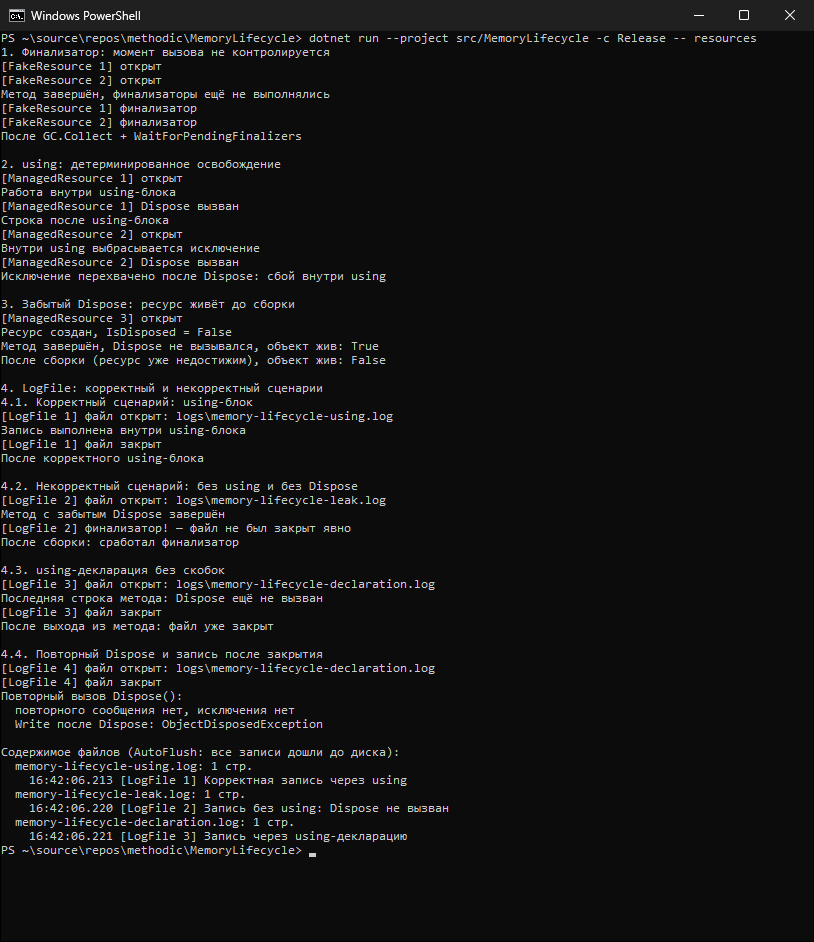

# КТ №42. Финализируемые объекты. IDisposable. using

**Вариант:** 2 — «Лог-файл» (дополнительно показаны классы из разбора кода: `FakeResource`, `ManagedResource`).
**Команда:** `dotnet run --project src/MemoryLifecycle -c Release -- resources`

## Что реализовано

| Файл | Назначение |
|---|---|
| `src/MemoryLifecycle/Resources/FakeResource.cs` | Ресурс только с финализатором, без `IDisposable` |
| `src/MemoryLifecycle/Resources/ManagedResource.cs` | `IDisposable` с флагом `disposed`, повторный `Dispose()` игнорируется |
| `src/MemoryLifecycle/Resources/LogFile.cs` | Обёртка над `StreamWriter`: `IDisposable` + финализатор-сигнализатор утечки |
| `src/MemoryLifecycle/Demos/ResourceDemos.cs` | Консольные сценарии |

Выполнение условий варианта 2:

1. `LogFile : IDisposable` оборачивает `StreamWriter` (`AutoFlush = true`). Конструктор выводит «файл открыт»,
   `Dispose()` — «файл закрыт».
2. Финализатор выводит «финализатор! — файл не был закрыт явно» и **не трогает** `StreamWriter`:
   это управляемый объект, к моменту финализации он мог быть уже финализирован.
3. Корректный сценарий (4.1): `using`-блок, запись, автоматический `Dispose()` в конце блока.
4. Некорректный сценарий (4.2): без `using` и без `Dispose()`, затем `GC.Collect()` и `GC.WaitForPendingFinalizers()`.
5. `using`-декларация без скобок (4.3): `using var log = new LogFile(...)` — `Dispose()` в конце метода.

Дополнительно: `Dispose()` вызывает `GC.SuppressFinalize(this)`, поэтому после явного закрытия ложного сообщения
об утечке нет; `Write()` после закрытия выбрасывает `ObjectDisposedException` (`ObjectDisposedException.ThrowIf`);
повторный `Dispose()` молча возвращается (4.4); для каждого сценария используется **свой файл** в каталоге `logs`
(исключён в `.gitignore`); в конце выводится содержимое файлов как доказательство, что записи дошли до диска.
Сценарий 2 показывает, что `using` вызывает `Dispose()` и при исключении (разворачивается в `try/finally`),
сценарий 3 — через `WeakReference`, что без `Dispose()` объект живёт до сборки.

## Вывод программы

```text
PS> dotnet run --project src/MemoryLifecycle -c Release -- resources
1. Финализатор: момент вызова не контролируется
[FakeResource 1] открыт
[FakeResource 2] открыт
Метод завершён, финализаторы ещё не выполнялись
[FakeResource 1] финализатор
[FakeResource 2] финализатор
После GC.Collect + WaitForPendingFinalizers

2. using: детерминированное освобождение
[ManagedResource 1] открыт
Работа внутри using-блока
[ManagedResource 1] Dispose вызван
Строка после using-блока
[ManagedResource 2] открыт
Внутри using выбрасывается исключение
[ManagedResource 2] Dispose вызван
Исключение перехвачено после Dispose: сбой внутри using

3. Забытый Dispose: ресурс живёт до сборки
[ManagedResource 3] открыт
Ресурс создан, IsDisposed = False
Метод завершён, Dispose не вызывался, объект жив: True
После сборки (ресурс уже недостижим), объект жив: False

4. LogFile: корректный и некорректный сценарии
4.1. Корректный сценарий: using-блок
[LogFile 1] файл открыт: logs\memory-lifecycle-using.log
Запись выполнена внутри using-блока
[LogFile 1] файл закрыт
После корректного using-блока

4.2. Некорректный сценарий: без using и без Dispose
[LogFile 2] файл открыт: logs\memory-lifecycle-leak.log
Метод с забытым Dispose завершён
[LogFile 2] финализатор! — файл не был закрыт явно
После сборки: сработал финализатор

4.3. using-декларация без скобок
[LogFile 3] файл открыт: logs\memory-lifecycle-declaration.log
Последняя строка метода: Dispose ещё не вызван
[LogFile 3] файл закрыт
После выхода из метода: файл уже закрыт

4.4. Повторный Dispose и запись после закрытия
[LogFile 4] файл открыт: logs\memory-lifecycle-declaration.log
[LogFile 4] файл закрыт
Повторный вызов Dispose():
  повторного сообщения нет, исключения нет
  Write после Dispose: ObjectDisposedException

Содержимое файлов (AutoFlush: все записи дошли до диска):
  memory-lifecycle-using.log: 1 стр.
    16:42:06.213 [LogFile 1] Корректная запись через using
  memory-lifecycle-leak.log: 1 стр.
    16:42:06.220 [LogFile 2] Запись без using: Dispose не вызван
  memory-lifecycle-declaration.log: 1 стр.
    16:42:06.221 [LogFile 3] Запись через using-декларацию
```



## Результаты

| Действие | Ожидалось | Получено |
|---|---|---|
| Выход из метода с `FakeResource` | Финализатор не вызывается немедленно | «Метод завершён, финализаторы ещё не выполнялись» |
| `GC.Collect()` + `GC.WaitForPendingFinalizers()` | Финализатор вызывается | `[FakeResource 1] финализатор`, `[FakeResource 2] финализатор` |
| `ManagedResource` в `using` | «Dispose вызван» точно в конце блока | Сообщение между «Работа внутри» и «Строка после» |
| Исключение внутри `using` | `Dispose()` всё равно вызван | «Dispose вызван» раньше, чем исключение перехвачено |
| `LogFile` в `using` | «Файл закрыт» до следующей строки после блока | `[LogFile 1] файл закрыт` → «После корректного using-блока» |
| `LogFile` без `using` + `GC.Collect()` | «Финализатор!» — освобождение через GC | `[LogFile 2] финализатор! — файл не был закрыт явно` |
| `using`-декларация | Освобождение в конце области видимости | «Последняя строка метода» → `[LogFile 3] файл закрыт` |
| Повторный `Dispose()` | Без повторного закрытия и без исключения | Повторного сообщения нет |
| `Write()` после `Dispose()` | `ObjectDisposedException` | `ObjectDisposedException` |

## Анализ

- **Финализатор недетерминирован.** После выхода из `CreateFakeResources` объекты уже недостижимы, но финализаторы
  не выполнились: их вызывает сборщик в отдельном потоке финализации, когда сочтёт нужным. Увидеть их удалось только
  после явной сборки и `GC.WaitForPendingFinalizers()`, без которого сообщения могли не появиться до конца процесса.
- **`Dispose()` детерминирован.** В `using` он вызывается ровно на закрывающей скобке, а при исключении — до того,
  как исключение дойдёт до `catch`, так как компилятор разворачивает `using` в `try/finally`.
- **Забытый `Dispose()` — утечка до сборки.** Файл журнала `LogFile 2` оставался открытым, пока сборщик
  не нашёл объект; закрыть его вовремя мог только `Dispose()`. Для файла это означает удерживаемый дескриптор
  и (без `AutoFlush`) недописанный буфер.
- **`GC.SuppressFinalize` в `LogFile.Dispose()`** убирает объект из очереди финализации: для `LogFile 1`, `3` и `4`
  после сборки сообщения финализатора нет.

## Выводы

1. Финализатор — последний шанс, а не основной механизм очистки: момент его вызова не контролируется.
2. `IDisposable` + `using` дают детерминированное освобождение, в том числе при исключении.
3. `Dispose()` должен быть идемпотентным (флаг `disposed`), а работа с закрытым объектом — давать `ObjectDisposedException`.
