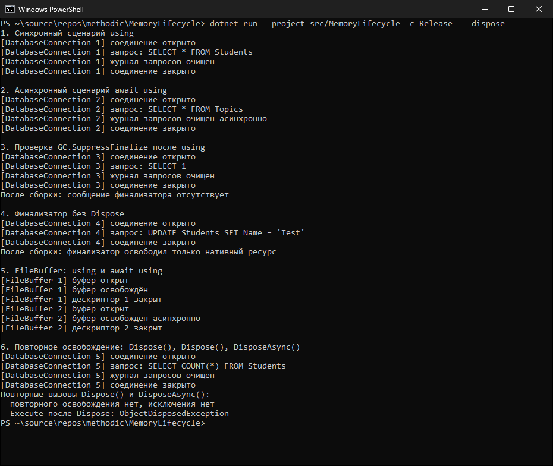

# КТ №43. Паттерн Dispose. IAsyncDisposable (.NET 10)

**Вариант:** 1 — «Соединение с базой данных» (дополнительно — `FileBuffer` из разбора кода).
**Команда:** `dotnet run --project src/MemoryLifecycle -c Release -- dispose`

## Что реализовано

| Файл | Назначение |
|---|---|
| `src/MemoryLifecycle/Resources/DatabaseConnection.cs` | `IDisposable, IAsyncDisposable`, полный паттерн Dispose |
| `src/MemoryLifecycle/Resources/FileBuffer.cs` | Та же схема для файлового буфера (`MemoryStream` + дескриптор) |
| `src/MemoryLifecycle/Demos/DisposeDemos.cs` | Синхронный и асинхронный сценарии |

Выполнение условий варианта 1:

1. `DatabaseConnection : IDisposable, IAsyncDisposable`: управляемый ресурс — `List<string> queryLog` (журнал запросов),
   «нативный» — `int connectionId`.
2. `protected virtual void Dispose(bool disposing)`: журнал очищается только при `disposing == true`,
   соединение закрывается всегда. Класс не `sealed`, чтобы метод мог быть `protected virtual`
   (наследник переопределяет `Dispose(bool)` и `DisposeAsyncCore()` и вызывает базовую реализацию).
3. Публичный `Dispose()` вызывает `Dispose(true)` и `GC.SuppressFinalize(this)`.
4. Финализатор `~DatabaseConnection()` вызывает `Dispose(false)`.
5. `DisposeAsync()` вызывает `DisposeAsyncCore()` (асинхронное закрытие имитируется `await Task.Delay(10)`),
   затем в `finally` — `Dispose(false)` и `GC.SuppressFinalize(this)`: нативный ресурс закрывается
   даже при исключении в асинхронной части.
6. Показаны оба сценария: `using (new DatabaseConnection())` и `await using (new DatabaseConnection())`
   в методе `async Task`.

Проверка `disposed` есть и в `Dispose(bool)`, и в `DisposeAsyncCore()` — повторные `Dispose()`/`DisposeAsync()`
ничего не делают (сценарий 6).

## Вывод программы

```text
PS> dotnet run --project src/MemoryLifecycle -c Release -- dispose
1. Синхронный сценарий using
[DatabaseConnection 1] соединение открыто
[DatabaseConnection 1] запрос: SELECT * FROM Students
[DatabaseConnection 1] журнал запросов очищен
[DatabaseConnection 1] соединение закрыто

2. Асинхронный сценарий await using
[DatabaseConnection 2] соединение открыто
[DatabaseConnection 2] запрос: SELECT * FROM Topics
[DatabaseConnection 2] журнал запросов очищен асинхронно
[DatabaseConnection 2] соединение закрыто

3. Проверка GC.SuppressFinalize после using
[DatabaseConnection 3] соединение открыто
[DatabaseConnection 3] запрос: SELECT 1
[DatabaseConnection 3] журнал запросов очищен
[DatabaseConnection 3] соединение закрыто
После сборки: сообщение финализатора отсутствует

4. Финализатор без Dispose
[DatabaseConnection 4] соединение открыто
[DatabaseConnection 4] запрос: UPDATE Students SET Name = 'Test'
[DatabaseConnection 4] соединение закрыто
После сборки: финализатор освободил только нативный ресурс

5. FileBuffer: using и await using
[FileBuffer 1] буфер открыт
[FileBuffer 1] буфер освобождён
[FileBuffer 1] дескриптор 1 закрыт
[FileBuffer 2] буфер открыт
[FileBuffer 2] буфер освобождён асинхронно
[FileBuffer 2] дескриптор 2 закрыт

6. Повторное освобождение: Dispose(), Dispose(), DisposeAsync()
[DatabaseConnection 5] соединение открыто
[DatabaseConnection 5] запрос: SELECT COUNT(*) FROM Students
[DatabaseConnection 5] журнал запросов очищен
[DatabaseConnection 5] соединение закрыто
Повторные вызовы Dispose() и DisposeAsync():
  повторного освобождения нет, исключения нет
  Execute после Dispose: ObjectDisposedException
```



## Результаты

| Действие | Ожидалось | Получено |
|---|---|---|
| `using (new DatabaseConnection())` | Синхронная очистка: журнал очищен, соединение закрыто | «журнал запросов очищен» → «соединение закрыто» |
| `await using (new DatabaseConnection())` | Асинхронная очистка журнала, затем закрытие соединения | «журнал запросов очищен асинхронно» → «соединение закрыто» |
| Проверка `GC.SuppressFinalize` | После `Dispose()` финализатор не вызывается | После сборки второго «соединение закрыто» нет |
| Финализатор без `Dispose()` | Только закрытие нативного ресурса | Только «соединение закрыто», без строки про журнал |
| `FileBuffer`: `using` / `await using` | Буфер освобождён, дескриптор закрыт ровно один раз | По одному сообщению каждого вида |
| Повторные `Dispose()`, `DisposeAsync()` | Без повторного освобождения и без исключения | Сообщений нет; `Execute` после закрытия — `ObjectDisposedException` |

## Анализ

- **Разделение ресурсов через `disposing`.** В сценарии 4 финализатор вызвал `Dispose(false)`: в выводе только
  «соединение закрыто», строки «журнал запросов очищен» нет. Это доказывает, что финализатор не трогает управляемый
  `List<string>` — к моменту финализации он мог быть уже собран.
- **`GC.SuppressFinalize` работает.** В сценарии 3 после `using` выполнены `GC.Collect()` и `GC.WaitForPendingFinalizers()`,
  но повторного «соединение закрыто» от финализатора нет: `Dispose()` убрал объект из очереди финализации,
  поэтому объект не проживает лишнее поколение.
- **Синхронный и асинхронный пути.** `using` вызывает `Dispose()` → `Dispose(true)`. `await using` вызывает
  `DisposeAsync()` → `DisposeAsyncCore()` (очистка журнала после `await`) → `Dispose(false)` (только нативный ресурс),
  поэтому журнал не очищается дважды.
- **Зачем оба интерфейса.** Код, который знает только `IDisposable` (обычный `using`), тоже может освободить
  соединение; асинхронный код использует `await using` и не блокирует поток на время закрытия.

## Выводы

1. Полный паттерн Dispose разделяет управляемые (`disposing == true`) и нативные (всегда) ресурсы.
2. `GC.SuppressFinalize` вызывается и в `Dispose()`, и в `DisposeAsync()`, иначе финализатор отработает повторно.
3. `DisposeAsync()` закрывает нативный ресурс в `finally`, а проверка `disposed` в `DisposeAsyncCore()`
   защищает от повторной очистки.
